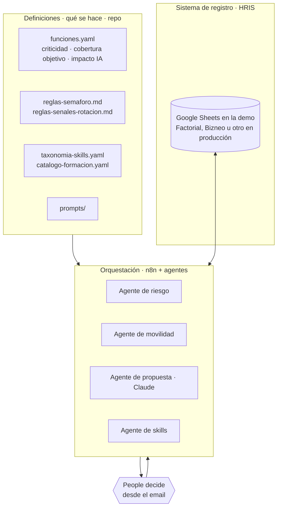

# People OS · Acme

**Capa de orquestación y agentes sobre el HRIS de una compañía de 160 personas, para que una sola persona gestione el 360º de RRHH.**

Prueba técnica. Acme es una fintech cripto regulada y ficticia (MiCA, sujeto obligado AML) en pleno plan *AI first*. Todos los datos (personas, skills, salarios, encuestas) son inventados.

**Lo que hace, en una línea:** se va la responsable de custodia → el sistema recalcula el riesgo, propone cómo cubrir el puesto y a quién retener → People aprueba desde el email → el mapa vuelve a cambiar → tres meses después, un manager valida una skill y el riesgo baja.

---

## 1. El problema y el criterio

La pregunta de partida no es "cómo automatizo RRHH", es **qué debe seguir haciendo una persona y qué no**. Mi respuesta:

| Tipo de trabajo | Quién lo hace | Ejemplo |
|---|---|---|
| Repetitivo y calculable | Automatización | Recalcular quién cubre qué cuando alguien se va |
| Texto → datos, datos → texto | IA, con revisión humana | Normalizar skills; redactar una propuesta para dirección |
| Decisiones sobre personas | **Humano** | Aprobar una movilidad, una contratación, un plan de formación |
| Conversaciones | **Humano** | Permanencia, feedback, salidas |

Un límite que no se cruza: **la IA no decide nada sobre una persona.** Propone, redacta y el humano decide, y queda registrado. El AI Act europeo trata la IA en decisiones de empleo como alto riesgo; aquí el riesgo, el semáforo y los candidatos salen de reglas que se pueden leer y comprobar, no de un modelo.

**El proceso elegido para la demo:** cobertura de funciones críticas y riesgo de salida. En una empresa regulada, una función sin cobertura (custodia, AML, seguridad) pone en riesgo la licencia. Y es lo que una persona sola no puede hacer a mano: cruzar 160 personas, 39 skills y 24 funciones cada vez que algo cambia.

## 2. Arquitectura

**Principio: separar qué se hace (definiciones y reglas) de quién lo ejecuta (orquestador y agentes).** Cambiar un umbral es editar un archivo, no rehacer un flujo. Y el orquestador se puede cambiar sin perder la lógica.



| Capa | Qué contiene | Dónde | Quién la cambia |
|---|---|---|---|
| **HRIS** | Empleados, skills validadas, planes, encuesta agregada | Google Sheets (demo) | People y managers |
| **Definiciones** | Funciones y criticidad, reglas, umbrales, taxonomía, catálogo, prompts | `definiciones/`, `prompts/` | People, editando un archivo |
| **Orquestación y agentes** | Disparadores, cálculo, propuesta, avisos, aprobación | n8n (`flujos/n8n/`) con el motor de `calculo/` | — |
| **Decisión** | Aprobar, descartar, validar | Email a People, formulario del manager | Humano, siempre |

**Sobre el HRIS.** No he construido un HRIS ni quiero hacerlo. Google Sheets hace de sistema de registro en la demo porque es lo que permite enseñar el 360º en tres días. Los nodos `Leer empleados`, `Actualizar skills`, `Guardar planes` son el **adaptador**: en producción apuntan a la API de Factorial, Bizneo o el HRIS que use la compañía. Definiciones, motor de cálculo y flujos no cambian.

**Dónde está la IA y dónde no.** Sí: convertir texto en datos (captura de skills) y datos en texto (propuestas, informes). No: el riesgo. Si alguien pregunta "¿por qué está en rojo?", la respuesta es una regla de `definiciones/reglas-semaforo.md`, no una opinión del modelo. Y si la API de Claude no responde, el flujo sigue con una propuesta generada por reglas: el sistema nunca se queda en blanco.

## 3. Los agentes

Pocos agentes, cada uno con una tarea concreta, encadenados. Una salida de uno es la entrada del siguiente.

| Agente | Qué hace | Áreas que toca | Estado |
|---|---|---|---|
| **Riesgo** | Cuando algo cambia (baja, validación, aprobación), recalcula cobertura y semáforo por función, descubre *key people* (incluidas las ocultas entre áreas), asigna prioridad y decide si la función se **cubre** o se **rediseña con IA** | Talento, desarrollo, organización | Funciona |
| **Movilidad** | Ante una vacante, calcula el perfil del puesto, busca candidatos internos, sus brechas, la formación que las cierra y el **coste organizativo** de moverlos (por ejemplo, que ya sean key person) | Talento, compensación | Funciona |
| **Propuesta** (Claude) | Redacta para People las opciones (buscar fuera o mover dentro), los planes de backup y las conversaciones de permanencia, con el porqué y el riesgo de no hacerlo. Si no hay IA, propuesta por reglas | Transversal | Funciona |
| **Skills** | El manager valida el nivel alcanzado → actualiza el HRIS, cierra el plan de backup y recalcula. Completar un curso no sube el nivel: lo valida una persona | Desarrollo | Funciona |
| **Captura** | Texto libre del empleado → skills normalizadas contra la taxonomía → el manager valida | Desarrollo | Diseñado (`prompts/normalizar-skills.md`), probado en n8n, no en la demo |
| **Asistente de People** | Preguntas en lenguaje natural sobre el mapa: "¿quién puede cubrir a Elena?" | Transversal | Propuesta (`agentes/`) |

Lo interconectado: **Riesgo** detecta → **Movilidad** calcula opciones → **Propuesta** las redacta → **People decide** → **Riesgo** recalcula → tres meses después **Skills** cierra el ciclo.

## 4. La demo

Dos escenarios en n8n, con datos de 160 personas y 24 funciones. Guion completo: [`docs/guion-demo.md`](docs/guion-demo.md). Cómo está montado: [`flujos/n8n/LEEME.md`](flujos/n8n/LEEME.md).

**Escenario 1 · Se va la responsable de custodia.**
1. Formulario de baja (en producción, el evento lo dispara el HRIS).
2. El agente de riesgo recalcula: *Gestión de claves* pasa de verde a rojo, *Prueba de reservas* se queda sin nadie. Marcos pasa a ser key person.
3. Llega un email a People. Primera decisión: cubrir el puesto. **Opción A**, buscar fuera (perfil calculado, 2-3 meses sin responsable). **Opción B**, mover a Marcos (cumple 3 de 5 skills; coste: ya es la única persona que firma claves, concentrar el puesto en él concentra el riesgo). Además: plan de backup para Javier, conversación de permanencia con Marcos. Y solo para People: su compa-ratio en la banda del puesto sería 0,76, la opción B exige revisar condiciones.
4. People aprueba desde el email. La otra opción se descarta sola, el cambio se aplica, el mapa se recalcula.

**Escenario 2 · Tres meses después.** El manager valida que Javier ha alcanzado el nivel. El plan se cierra, el recálculo devuelve *Gestión de claves* a verde, llega el email "Riesgo reducido".

**El dato que nadie tenía.** Elena tenía cuatro señales de rotación (compa-ratio 0,86, 22 meses sin revisión, clima de su área bajo, evaluación 5) y sostenía una función crítica. El sistema la tenía como prioridad 1 antes de irse. Eso es lo que cambia: no es un mapa para mirar, es un sistema que avisa y propone antes.

## 5. Decisiones técnicas

Registro completo con alternativas y porqués: [`docs/decisiones.md`](docs/decisiones.md). Las que importan:

- **n8n** (D-04): elegido con una prueba, no con una opinión. Los flujos se exportan como JSON y se versionan aquí; el nodo de código ejecuta el mismo motor que se verifica en local (`npm run verificar`), no una segunda implementación. Alternativa descartada: Make, que domino más pero obliga a duplicar el cálculo en fórmulas.
- **Un motor de cálculo en el repo** (D-10): `calculo/` es la referencia; `npm run n8n` genera el código de los nodos. Una sola versión de la lógica, probada antes de cada ensayo (`npm run probar-n8n`). Si mañana no es n8n, el motor sirve igual.
- **Las definiciones se leen en tiempo de ejecución desde GitHub** (D-16): cambiar una regla es un commit; n8n la ve en la siguiente ejecución.
- **La IA propone, la regla decide** (D-14, D-15): candidatos, prioridades y "cubrir o rediseñar" son reglas explícitas. Claude solo redacta.
- **Dos opciones, no una recomendación** (D-15): cubrir un puesto es una decisión de People y dirección. El sistema pone el coste de cada opción encima de la mesa.
- **Demo local como plan B** (D-12): `npm run demo` recorre el ciclo entero sin n8n ni red.

## 6. Cómo se amplía al 360º

Cada proceso nuevo se construye con las mismas cuatro piezas: definiciones en `definiciones/`, datos sobre el **registro único de personas** del HRIS, una regla determinista para lo que decide riesgos o prioridades, y un flujo con disparo → regla → IA si hay texto → aviso → **decisión humana registrada**. Receta y ejemplo de onboarding: [`docs/escalado.md`](docs/escalado.md).

| Proceso | Se automatiza | Hace la IA | Decide el humano | Estado |
|---|---|---|---|---|
| Skills y cobertura | Recálculo, semáforo, key people, alertas | Captura, propuestas, informe | Manager valida; People aprueba | **Construido** |
| Movilidad interna | Candidatos y coste de moverlos | Explica opciones | People y managers | **Construido** (sale del mapa) |
| Formación | Plan dirigido al riesgo | Propone itinerario | People | **Construido** (sale del mapa) |
| Rotación no deseada | Señales objetivas sobre key people | — | People conversa | **Construido** (solo People) |
| Compensación | Compa-ratio, prioridad de revisión | Redacta propuesta al comité | Comité | Diseñado (`docs/usos-mapa-cobertura.md`) |
| Clima | Cruce con el mapa, agregados n ≥ 5 | Resume comentarios | Dirección | Diseñado |
| Onboarding / offboarding | Plan por rol, alta en el mapa; la baja **dispara el recálculo** | Email del día 0 | Manager | Diseñado (`docs/escalado.md`) |
| Selección | Publicación, agenda | Primer cribado explicado (alto riesgo: con cautela) | Manager y People | Fuera de alcance |
| Desempeño | Recordatorios del ciclo | Resumen de evidencias | Manager | Fuera de alcance |
| Administración y nómina | Variables (altas, bajas, incentivos) → HRIS o gestoría | — | — | Fuera de alcance: no se reinventa |

Detalle de cada proceso: [`docs/vision-procesos-rrhh.md`](docs/vision-procesos-rrhh.md).

## 7. El mismo mapa, en el plan AI first

El sistema que dice dónde somos frágiles dice también **qué funciones va a cambiar la IA y quién está preparado**: madurez IA por área (tres skills transversales), impacto IA por función y una regla explícita: *función en rojo con impacto IA alto → rediseñar y recualificar, no formar un backup en el proceso actual.* Con los datos ficticios, el cruce señala CX y Compliance: muchas personas, madurez baja, funciones de impacto alto.

La primera función que el sistema propone rediseñar con IA es la propia *Gestión de personas* (PEO-01): está en rojo, depende de una persona y tiene impacto IA alto. Por eso esta prueba está construida como trabajaría el departamento: una persona más IA, y todo documentado en un repo, no en una cabeza. Cómo lo llevaría desde People en 90 días, con las cuatro palancas (adopción, herramientas, formación, estructura): [`docs/plan-ai-first-people.md`](docs/plan-ai-first-people.md).

## 8. Qué no está hecho y límites

- **No es producción.** Los botones de aprobar son enlaces sin identificación; el formulario de skill no comprueba que quien valida sea el manager. En producción: login de People y del manager, y registro de quién aprobó qué.
- **Sheets llega hasta ~200 personas.** Después, base de datos o directamente el HRIS. Las definiciones y las reglas no cambian.
- **El mapa vale lo que valga la validación de skills.** Solo cuentan las validadas por el manager; hace falta una cadencia semestral, que el sistema puede recordar. Es el límite número 1 del sistema.
- **Privacidad.** Las señales de rotación, los salarios y el impacto IA los ve solo People y dirección; los managers nunca ven señales individuales. En la demo se representa con hojas protegidas; en producción, permisos por rol. `impacto_ia` describe funciones, no personas: no es una lista de nadie.
- **Sin modelo predictivo de fuga.** Por ética, por el AI Act y por los datos: con 160 personas y pocas salidas al año no hay muestra. Las señales llevan a una conversación, no a una etiqueta.
- **La captura de skills y el onboarding** están diseñados y no construidos. Con tres días, un proceso entero que funciona vale más que dos a medias.

## Cómo reproducirlo

```bash
npm install
npm run verificar   # comprueba que datos y reglas producen los casos de la demo
npm run demo -- reset && npm run demo -- baja E007   # el ciclo entero en local, sin n8n
```

Para montarlo en n8n (20 min, tres credenciales): [`flujos/n8n/LEEME.md`](flujos/n8n/LEEME.md). Los flujos están en [`flujos/n8n/`](flujos/n8n/).

## Mapa del repo

| Carpeta | Qué hay |
|---|---|
| `definiciones/` | Qué se hace: funciones, reglas, taxonomía, catálogo, contexto de Acme |
| `prompts/` | Lo que se le pide a Claude: normalizar skills, proponer acciones, informe a dirección |
| `calculo/` | Motor de cálculo de referencia, verificación y demo local |
| `flujos/n8n/` | Los dos escenarios exportados y su código fuente |
| `datos/`, `salidas/` | Datos ficticios de origen y hojas calculadas (lo que carga el Sheet) |
| `agentes/` | Agentes propuestos y herramientas de trabajo |
| `docs/` | Arquitectura, decisiones, escalado, guion de la demo, usos del mapa, plan AI first |
