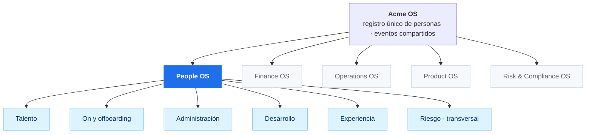
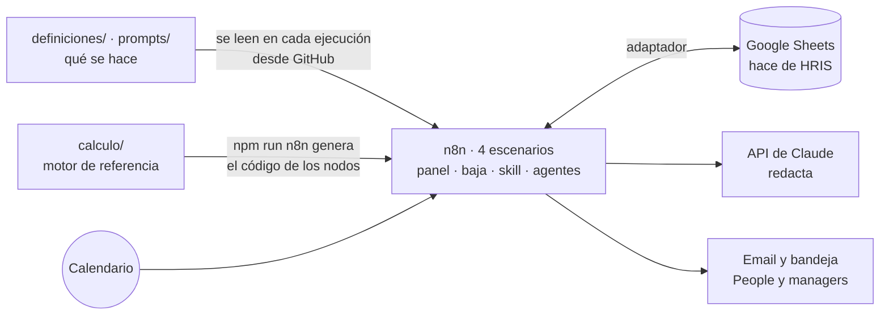

# People OS · Acme

**Cómo gestionaría una sola persona el 360º de RRHH de una compañía de 160 personas, orquestando agentes sobre el HRIS en lugar de construir uno nuevo.**

Prueba técnica. Acme es una fintech cripto regulada y ficticia (MiCA, sujeto obligado AML) en pleno plan *AI first*. Todos los datos (personas, skills, salarios, encuestas) son inventados.

El README va de lo general a lo concreto:

1. **[Visión](#parte-1--visión-people-os)**: el plano completo de People OS y cómo encaja en la compañía. Casi todo es diseño.
2. **[Alcance de la demo](#parte-2--la-demo-se-va-elena)**: un caso construido de principio a fin, la salida de una persona clave, y cómo probarlo.
3. **[Parte técnica](#parte-3--cómo-está-construido)**: cómo está hecho el repo, qué decidí y por qué, y sus límites.

**Pruébalo sin instalar nada:** con el enlace del panel que va en el mensaje de la prueba (detalle en la [parte 2](#cómo-probarlo)).

---

## Parte 1 · Visión: People OS

> Esta parte es el **plano completo**: cómo construiría People OS para cubrir el 360º con una sola persona. Lo que funciona hoy está en la parte 2 y aparece como **Construido** en las tablas. El resto es diseño.

### 1.1 El criterio: qué hace una persona y qué no

La pregunta de partida no es "cómo automatizo RRHH", es **qué debe seguir haciendo una persona**.

| Tipo de trabajo | Quién lo hace | Ejemplo |
|---|---|---|
| Repetitivo y calculable | Automatización | Recalcular quién cubre qué cuando alguien se va |
| Texto → datos, datos → texto | IA, con revisión humana | Normalizar skills; redactar una propuesta para dirección |
| Decisiones sobre personas | **Humano** | Aprobar una movilidad, una contratación, un plan de formación |
| Conversaciones | **Humano** | Permanencia, feedback, salidas |

Un límite que no se cruza: **la IA no decide nada sobre una persona.** Propone y redacta; decide People o el manager, y queda registrado. El AI Act europeo trata la IA en decisiones de empleo como alto riesgo.

### 1.2 People OS dentro de la compañía

People OS no es un departamento aislado ni un HRIS nuevo. Es **uno de los módulos de Acme OS**, el sistema operativo de la compañía, junto a Finance, Operations, Product o Risk & Compliance. Todos cuelgan de Acme OS y comparten dos cosas:

- **Un registro único de personas** (el HRIS): quién es quién, su rol, su equipo y sus skills. Ningún módulo mantiene su propia lista de personas.
- **Eventos**: cuando algo pasa en un módulo, los demás se enteran y actúan. Una alta en People abre cuentas en IT y avisa a Finanzas para la nómina. Un cambio regulatorio en Cumplimiento puede subir la criticidad de una función en People.



### 1.3 Principio: orquestar, no reinventar

Tres capas, cada una con un dueño distinto:

| Capa | Qué es | Herramienta | Quién la cambia |
|---|---|---|---|
| **Sistema de registro** | Empleados, ausencias, documentos, nómina | El HRIS de la compañía (Factorial, Bizneo u otro). En la demo, Google Sheets | No se reinventa: se conecta por API |
| **Definiciones** | Reglas, umbrales, criticidad de funciones, catálogos, prompts | Archivos en el repo | People, editando un archivo, sin tocar flujos |
| **Orquestación y agentes** | Disparadores, cálculo, propuestas, avisos, aprobaciones | n8n + Claude | Nadie a mano: ejecuta lo que dicen las definiciones |

La conexión con el HRIS es un **adaptador**. Si la compañía cambia de HRIS, se cambia el adaptador; definiciones, reglas y agentes siguen igual.

### 1.4 Las áreas y sus agentes

Pocos agentes por área, cada uno con una tarea concreta. Ninguno decide sobre una persona: detectan, calculan, proponen y redactan.

| Área | Agente | Qué hace | Estado |
|---|---|---|---|
| **Talento** | Movilidad | Ante una vacante, busca candidatos internos, sus brechas y el coste de moverlos | **Construido** |
| | Selección | Publica la oferta, agenda entrevistas, primer cribado explicado (alto riesgo: siempre con revisión humana) | Diseño |
| | Sucesión | Mantiene un backup para cada función crítica y avisa cuando falta | Diseño (sale del mapa de riesgo) |
| **On y offboarding** | Onboarding | Plan por rol, cuentas, buddy, seguimiento a 30, 60 y 90 días; la persona entra en el mapa desde el día 1 | Diseño |
| | Offboarding | Checklist, bajas de accesos, traspaso de conocimiento; **la baja dispara el recálculo de riesgo** | Diseño (el disparo está construido) |
| **Administración** | Administración | Vacaciones, solicitudes, documentos y variables de nómina (altas, bajas, incentivos) hacia el HRIS o la gestoría. No calcula nóminas | Diseño |
| **Desarrollo** | Skills | El manager valida un nivel, se actualiza el registro y se recalcula | **Construido** |
| | Seguimiento de planes | Cada lunes persigue al manager cuando un plan de formación llega a su fecha | **Construido** |
| | Captura | Texto libre del empleado → skills normalizadas → el manager valida | Diseño (probado en n8n) |
| | Desempeño | Recordatorios del ciclo y resumen de evidencias para el manager | Diseño |
| **Experiencia** | Escucha | Encuestas y clima, siempre agregados (n ≥ 5); detecta señales de desenganche | Diseño |
| **Transversal** | Riesgo | Recalcula cobertura, key people y prioridad cada vez que algo cambia; decide si una función se cubre o se rediseña con IA | **Construido** |
| | Propuesta | Redacta para People las opciones con su porqué y su coste | **Construido** |
| | Centinela | Cada mes vigila que nada se degrade en silencio e informa a dirección | **Construido** |
| | Asistente de People | Responde en lenguaje natural: "¿dónde somos frágiles?", "¿quién puede cubrir a Elena?" | Diseño |

### 1.5 Cómo se hablan los agentes

Lo importante no es cada agente, sino las cadenas: la salida de uno es la entrada del siguiente.

- **Se va alguien:** Offboarding registra la baja → Riesgo recalcula → Movilidad busca opciones → Propuesta las redacta → People decide → Riesgo recalcula. *(Construido, salvo el checklist de offboarding. Es la parte 2.)*
- **Alguien aprende:** Seguimiento avisa al manager → el manager valida → Skills actualiza → Riesgo baja el semáforo → Centinela lo refleja en el informe mensual. *(Construido.)*
- **Entra alguien:** Selección cierra la oferta → Onboarding lanza el plan por rol → avisa a IT y Finanzas → Skills registra las skills objetivo → Riesgo ve la nueva cobertura desde el día 1. *(Diseño.)*
- **Algo empeora sin que nadie lo diga:** Escucha detecta clima bajo en un área → Riesgo cruza con key people → Propuesta prepara una conversación de permanencia → People conversa. *(Diseño.)*

### 1.6 Qué hace la persona de People

Con este sistema, una persona no ejecuta procesos: **los supervisa**. Su trabajo es lo que no se automatiza:

- Decidir: aprobar una movilidad, una contratación, un plan de formación.
- Conversar: permanencia, feedback, salidas.
- Mantener las definiciones: qué es una función crítica, qué umbral dispara una alerta.
- Pactar con dirección y con cada área los objetivos.

### 1.7 El mismo sistema, en el plan AI first

El mapa que dice dónde somos frágiles dice también **qué funciones va a cambiar la IA y quién está preparado**: madurez IA por área, impacto IA por función y una regla explícita. Si una función está en rojo y su impacto IA es alto, la respuesta es rediseñarla y recualificar, no formar un backup en el proceso actual. Con los datos ficticios, el cruce señala CX y Compliance: muchas personas, madurez baja, funciones de impacto alto.

La primera función que el sistema propone rediseñar es la propia **Gestión de personas**: está en rojo, depende de una persona y tiene impacto IA alto. Por eso People OS está construido como trabajaría el departamento: una persona más IA, y todo documentado en un repo, no en una cabeza. Plan a 90 días con cuatro palancas (adopción, herramientas, formación, estructura): [`docs/plan-ai-first-people.md`](docs/plan-ai-first-people.md).

---

## Parte 2 · La demo: se va Elena

### Por qué este caso

De todo el plano, he construido una cadena completa: **cobertura de funciones críticas y riesgo de salida**. Es la que mejor responde a la pregunta de un CEO, *¿dónde somos frágiles?*, por tres motivos:

- En una empresa regulada, una función sin cobertura (custodia, AML, seguridad) pone en riesgo la licencia.
- Es lo que una persona sola no puede hacer a mano: cruzar 160 personas, 39 skills y 24 funciones cada vez que algo cambia.
- El mapa que resulta alimenta casi todas las demás áreas: movilidad, formación, retención, compensación y el plan AI first.

El caso: **Elena, responsable de custodia, se va.** Era la única persona que sabía hacer la prueba de reservas.

### La historia, paso a paso

**Escenario 1 · La baja.**
1. Se registra la baja de Elena (en la demo, un formulario; en producción, el evento lo dispara el HRIS).
2. **Riesgo** recalcula: *Gestión de claves* pasa de verde a rojo, *Prueba de reservas* se queda sin nadie. Marcos pasa a ser key person: ahora es el único que firma claves.
3. **Movilidad** calcula el perfil del puesto que queda libre y busca candidatos internos.
4. **Propuesta** redacta un email a People con la primera decisión, cubrir el puesto:
   - **Opción A**, buscar fuera: perfil calculado, 2-3 meses con el equipo de 7 personas sin responsable.
   - **Opción B**, mover a Marcos: cumple 3 de 5 skills del puesto. Coste: si asume el puesto, todo el riesgo de custodia se concentra en él.
   - Además: plan de backup para Javier (a un nivel y con interés declarado) y conversación de permanencia con Marcos.
   - Solo para People, en un bloque aparte: si Marcos asume el puesto con su salario actual, su compa-ratio en la banda sería 0,76. La opción B exige revisar condiciones.
5. **People decide** desde el email. La otra opción se descarta sola, el cambio se aplica y Riesgo recalcula.

**Escenario 2 · Tres meses después.** **Seguimiento de planes** detecta que el plan de Javier ha llegado a su fecha y escribe a Marcos con el formulario de validación rellenado. Marcos valida el nivel. **Skills** actualiza el registro y cierra el plan, Riesgo devuelve *Gestión de claves* a verde y llega el email "Riesgo reducido". Completar un curso no sube el nivel: lo valida una persona.

**Escenario 3 · Agentes que trabajan solos.** El plan de Marcos nadie lo valida: Seguimiento recuerda a su manager y, tras dos avisos, abre una alerta para People. El día 1 del mes, **Centinela** recalcula y deja el informe para dirección: *Prueba de reservas* sigue sin nadie, la conversación con Marcos lleva semanas sin decidirse y hay validaciones de skills antiguas que sostienen funciones críticas.

### El dato que nadie tenía

Elena tenía cuatro señales de rotación: compa-ratio 0,86, 22 meses sin revisión, clima de su área por debajo de la media y evaluación 5. Y sostenía una función crítica. **El sistema la tenía como prioridad 1 antes de que se fuera.** No es un mapa para mirar: es un sistema que avisa y propone antes.

### Qué agente actúa en cada paso

| Paso | Agente | Lo dispara | Decide |
|---|---|---|---|
| Recalcular el mapa | Riesgo | Una baja, una aprobación, una validación | Una regla |
| Opciones para cubrir el puesto | Movilidad | Una vacante | Una regla |
| Redactar la propuesta | Propuesta (Claude) | Cualquier empeoramiento | — (si Claude falla, la redacta una regla) |
| Aprobar | — | — | **People** |
| Avisar al manager | Seguimiento de planes | El calendario, cada lunes | Una regla |
| Validar el nivel | Skills | El manager | **Manager** |
| Informe mensual | Centinela | El calendario, día 1 | — |

### Cómo probarlo

Con el **enlace del panel** que va en el mensaje de la prueba. Es una página que sirve el propio n8n y muestra:

- qué hacer ahora, según el estado de la demo;
- el mapa en vivo y las key people;
- las decisiones pendientes, con su botón *Aprobar*;
- la bandeja de People, con la copia de cada email que genera el sistema;
- un botón para **reiniciar** la demo y empezar de cero.

Detrás no hay nada simulado: son los cuatro escenarios de n8n trabajando sobre el Sheet. Si dos personas la prueban a la vez comparten datos; se arregla con *Reiniciar*.

---

## Parte 3 · Cómo está construido

### Las piezas



| Carpeta | Qué hay |
|---|---|
| `definiciones/` | Qué se hace: funciones y criticidad, reglas del semáforo, señales de rotación, reglas de los agentes, taxonomía, catálogo de formación, contexto de Acme |
| `prompts/` | Lo que se le pide a Claude: normalizar skills, proponer acciones, informe a dirección |
| `calculo/` | Motor de cálculo de referencia, reglas de los agentes, verificación y demo local |
| `flujos/n8n/` | Los cuatro escenarios exportados (panel y reinicio, baja, skill, agentes autónomos) y su código fuente |
| `datos/`, `salidas/` | Datos ficticios de origen y hojas calculadas (lo que carga el Sheet) |
| `agentes/` | Ficha de cada agente: qué hace, qué no hace, dónde vive |
| `docs/` | Arquitectura, decisiones, escalado, guion de la demo, usos del mapa, plan AI first |
| `video/` | Reproductor de la demo, alimentado por el motor |

### Dónde está la IA y dónde no

- **Sí:** convertir texto en datos (captura de skills) y datos en texto (propuestas, informe a dirección).
- **No:** el riesgo. Semáforo, prioridad, key people, candidatos y "cubrir o rediseñar" salen de reglas que se pueden leer en [`definiciones/reglas-semaforo.md`](definiciones/reglas-semaforo.md) y comprobar con `npm run verificar`. Si alguien pregunta "¿por qué está en rojo?", la respuesta es una regla, no una opinión del modelo.
- **Si Claude no responde**, el flujo sigue con una propuesta generada por reglas. El sistema nunca se queda en blanco.

### Decisiones y por qué

Registro completo con alternativas: [`docs/decisiones.md`](docs/decisiones.md). Las que importan:

- **n8n** (D-04). Elegido con una prueba, no con una opinión. Los flujos se exportan como JSON y se versionan aquí. Descarté Make, que domino más, porque obligaba a duplicar el cálculo en fórmulas.
- **Un solo motor de cálculo, en el repo** (D-10). `calculo/` es la referencia y `npm run n8n` genera el código de los nodos. Una sola versión de la lógica, probada antes de cada cambio. Si mañana no es n8n, el motor sirve igual.
- **Definiciones leídas en tiempo de ejecución** (D-01, D-16). Cambiar una regla es un commit; n8n la ve en la siguiente ejecución, sin tocar el flujo.
- **Dos opciones, no una recomendación** (D-15). Cubrir un puesto es una decisión de People y dirección. El sistema pone el coste de cada opción encima de la mesa.
- **Agentes que actúan solos, con reglas** (D-21). Seguimiento y Centinela arrancan con el calendario, no con un clic. Deciden cuándo actuar y qué detectar; no suben niveles ni cierran planes. Aplacé el asistente conversacional: más vistoso, pero no determinista para que alguien lo pruebe solo.
- **Se prueba sin instalar nada** (D-22). El panel solo enseña lo que ya está en el Sheet, así que no puede contradecir a los flujos. La bandeja quita la dependencia de un buzón.
- **Lo confidencial, separado** (D-19). El resumen para dirección no lleva señales individuales ni salarios; eso va en un bloque solo para People. Los managers nunca ven señales de rotación.

### Cómo reproducirlo y verificarlo

```bash
npm install
npm run verificar    # datos y reglas producen los casos de la demo (18 comprobaciones)
npm run probar-n8n   # el código de los cuatro escenarios contra un Sheet simulado, dos vueltas seguidas
npm run cifras       # las cifras que citan los documentos, calculadas por el motor

# El ciclo entero en local, sin n8n ni red
npm run demo -- reset && npm run demo -- baja E007
npm run demo -- aprobar ALR-002 && npm run demo -- aprobar ALR-003
npm run demo -- seguimiento +84
npm run demo -- centinela +84
```

Montarlo en n8n (cuatro escenarios, tres credenciales, una vez): [`flujos/n8n/LEEME.md`](flujos/n8n/LEEME.md).

### Cómo se añade un proceso nuevo

Cada proceso del plano de la parte 1 se construye con las mismas cuatro piezas:

1. **Definiciones** en `definiciones/`: reglas, umbrales y catálogos. Sin lógica dentro del flujo.
2. **Datos** sobre el registro único de personas. Nunca una lista paralela.
3. **Una regla determinista** para todo lo que decide prioridades o riesgos, con su comprobación en `calculo/`.
4. **Un flujo**: disparo → regla → IA si hay texto → aviso → **decisión humana registrada**.

Receta completa con el ejemplo de onboarding: [`docs/escalado.md`](docs/escalado.md). Detalle de cada proceso del 360º: [`docs/vision-procesos-rrhh.md`](docs/vision-procesos-rrhh.md).

### Límites y qué no está hecho

- **No es producción.** Los botones de aprobar son enlaces sin identificación y el formulario de skill no comprueba que quien valida sea el manager. En producción: login de People y del manager, y registro de quién aprobó qué.
- **Sheets llega hasta unas 200 personas.** Después, base de datos o directamente el HRIS. Las definiciones y las reglas no cambian.
- **Algunos umbrales siguen en el código** (`calculo/cobertura.js`, `calculo/agentes.js`), documentados en `definiciones/`. El siguiente paso es moverlos a un archivo de definiciones, como el resto.
- **El mapa vale lo que valga la validación de skills.** Solo cuentan las validadas por el manager. El centinela ya señala cada mes las validaciones antiguas que sostienen funciones críticas. Es el límite número 1.
- **Privacidad.** Señales de rotación, salarios e impacto IA los ven solo People y dirección. En la demo se representa con una hoja aparte y protegida; en producción, permisos por rol. `impacto_ia` describe funciones, no personas.
- **Sin modelo predictivo de fuga.** Por ética, por el AI Act y por los datos: con 160 personas y pocas salidas al año no hay muestra. Las señales llevan a una conversación, no a una etiqueta.
- **Del plano de la parte 1, solo está construida una cadena.** Un proceso entero que funciona vale más que varios a medias.
