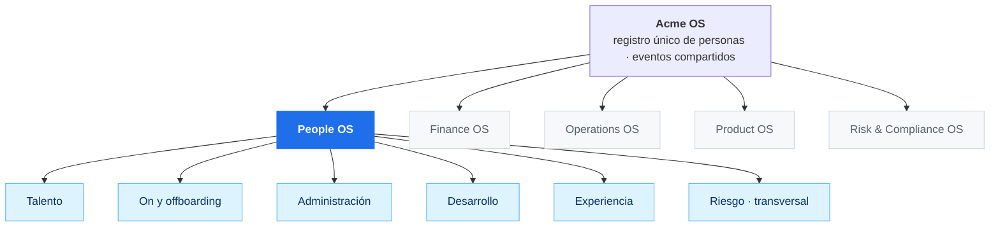
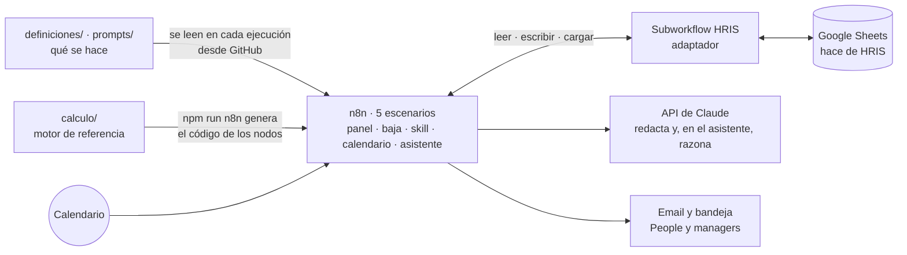

# People OS · Acme

**Cómo gestionaría una sola persona el 360º de RRHH de una compañía de 160 personas, orquestando automatizaciones, IA y un agente sobre el HRIS en lugar de construir uno nuevo.**

Prueba técnica. Acme es una fintech cripto regulada y ficticia (MiCA, sujeto obligado AML) en pleno plan *AI first*. Todos los datos (personas, skills, salarios, encuestas) son inventados.

El README va de lo general a lo concreto:

1. **[Visión](#parte-1--visión-people-os)**: el plano completo de People OS y cómo encaja en la compañía. Casi todo es diseño.
2. **[Alcance de la demo](#parte-2--la-demo-se-va-elena)**: un caso construido de principio a fin, la salida de una persona clave, y cómo probarlo.
3. **[Parte técnica](#parte-3--cómo-está-construido)**: cómo está hecho el repo, qué decidí y por qué, y sus límites.

**Pruébalo sin instalar nada:** con el enlace del panel que va en el mensaje de la prueba (detalle en la [parte 2](#cómo-probarlo)).

---

## Parte 1 · Visión: People OS

> Esta parte es el **plano completo**: cómo construiría People OS para cubrir el 360º con una sola persona. Lo que funciona hoy está en la parte 2 y aparece como **Construido** en las tablas. El resto es diseño.

### 1.1 El criterio: qué hace una persona y qué no

La pregunta de partida no es "cómo automatizo RRHH", es **qué debe seguir haciendo una persona**.

| Tipo de trabajo | Quién lo hace | Ejemplo |
|---|---|---|
| Repetitivo y calculable | Automatización | Recalcular quién cubre qué cuando alguien se va |
| Texto → datos, datos → texto | IA, con revisión humana | Normalizar skills; redactar una propuesta para dirección |
| Decisiones sobre personas | **Humano** | Aprobar una movilidad, una contratación, un plan de formación |
| Conversaciones | **Humano** | Permanencia, feedback, salidas |

Un límite que no se cruza: **la IA no decide nada sobre una persona.** Propone y redacta; decide People o el manager, y queda registrado. El AI Act europeo trata la IA en decisiones de empleo como alto riesgo.

### 1.2 People OS dentro de la compañía

People OS no es un departamento aislado ni un HRIS nuevo. Es **uno de los módulos de Acme OS**, el sistema operativo de la compañía, junto a Finance, Operations, Product o Risk & Compliance. Todos cuelgan de Acme OS y comparten dos cosas:

- **Un registro único de personas** (el HRIS): quién es quién, su rol, su equipo y sus skills. Ningún módulo mantiene su propia lista de personas.
- **Eventos**: cuando algo pasa en un módulo, los demás se enteran y actúan. Una alta en People abre cuentas en IT y avisa a Finanzas para la nómina. Un cambio regulatorio en Cumplimiento puede subir la criticidad de una función en People.



### 1.3 Principio: orquestar, no reinventar

Tres capas, cada una con un dueño distinto:

| Capa | Qué es | Herramienta | Quién la cambia |
|---|---|---|---|
| **Sistema de registro** | Empleados, ausencias, documentos, nómina | El HRIS de la compañía (Factorial, Bizneo u otro). En la demo, Google Sheets | No se reinventa: se conecta por API |
| **Definiciones** | Reglas, umbrales, criticidad de funciones, catálogos, prompts | Archivos en el repo | People, editando un archivo, sin tocar flujos |
| **Orquestación** | Disparadores, cálculo, propuestas, avisos, aprobaciones, el asistente | n8n + Claude | Nadie a mano: ejecuta lo que dicen las definiciones |

La conexión con el HRIS es un **adaptador**: en la demo, un subworkflow que es lo único que habla con Google Sheets (D-24). Si la compañía cambia de HRIS, se cambia el adaptador; definiciones, reglas y flujos siguen igual.

### 1.4 Las áreas y sus piezas

Pocas piezas por área, cada una con una tarea concreta, de tres tipos. Uso las palabras con precisión:

- **Automatización con reglas:** se dispara por un evento o por el calendario y decide con código determinista qué calcular y cuándo avisar. Es lo que fija riesgos y prioridades, porque tiene que poder auditarse y repetirse.
- **IA que redacta:** Claude convierte datos ya calculados en texto. Si falla, el texto sale por reglas.
- **Agente:** Claude decide qué herramientas usar y en qué orden para responder. Las herramientas son del motor, así que las cifras no las pone el modelo.

Ninguna decide sobre una persona.

| Área | Pieza | Tipo | Qué hace | Estado |
|---|---|---|---|---|
| **Talento** | Movilidad | Reglas | Ante una vacante, busca candidatos internos, sus brechas y el coste de moverlos | **Construido** |
| | Selección | Reglas + IA | Publica la oferta, agenda entrevistas, primer cribado explicado (alto riesgo: siempre con revisión humana) | Diseño |
| | Sucesión | Reglas | Mantiene un backup para cada función crítica y avisa cuando falta | Diseño (el plan de backup de una función que se queda sin cobertura ya lo proponen Propuesta y Seguimiento) |
| **On y offboarding** | Onboarding | Reglas | Plan por rol, cuentas, buddy, seguimiento a 30, 60 y 90 días; la persona entra en el mapa desde el día 1 | Diseño |
| | Offboarding | Reglas | Checklist, bajas de accesos, traspaso de conocimiento; **la baja dispara el recálculo de riesgo** | Diseño (el disparo está construido) |
| **Administración** | Administración | Reglas | Vacaciones, solicitudes, documentos y variables de nómina (altas, bajas, incentivos) hacia el HRIS o la gestoría. No calcula nóminas | Diseño |
| **Desarrollo** | Skills | Reglas | El manager valida un nivel, se actualiza el registro y se recalcula | **Construido** |
| | Seguimiento de planes | Reglas · calendario | Cada lunes persigue al manager cuando un plan de formación llega a su fecha | **Construido** |
| | Captura | IA | Texto libre del empleado → skills normalizadas → el manager valida | Diseño (probado en n8n) |
| | Desempeño | IA que redacta | Recordatorios del ciclo y resumen de evidencias para el manager | Diseño |
| **Experiencia** | Escucha | Reglas | Encuestas y clima, siempre agregados (n ≥ 5); detecta señales de desenganche | Diseño |
| **Transversal** | Riesgo | Reglas | Recalcula cobertura, key people y prioridad cada vez que algo cambia; decide si una función se cubre o se rediseña con IA | **Construido** |
| | Propuesta | IA que redacta | Redacta para People las opciones con su porqué y su coste | **Construido** |
| | Centinela | Reglas · calendario + IA que redacta | Cada mes vigila que nada se degrade en silencio e informa a dirección | **Construido** |
| | Asistente de People | **Agente** | Responde en lenguaje natural: "¿qué pasa si se va Carmen?", "¿quién puede cubrir la prueba de reservas?". Decide qué consultar; solo lee, sin salarios ni señales | **Construido** |

### 1.5 Cómo se encadenan

Lo importante no es cada pieza, sino las cadenas: la salida de una es la entrada de la siguiente.

- **Se va alguien:** se registra la baja (en la demo, un formulario; en producción, el HRIS) → Riesgo recalcula → Movilidad busca opciones → Propuesta las redacta → People decide → Riesgo recalcula. *(Construido, salvo el checklist de offboarding. Es la parte 2.)*
- **Alguien aprende:** Seguimiento avisa al manager → el manager valida → Skills actualiza → Riesgo baja el semáforo → Centinela lo refleja en el informe mensual. *(Construido.)*
- **Entra alguien:** Selección cierra la oferta → Onboarding lanza el plan por rol → avisa a IT y Finanzas → Skills registra las skills objetivo → Riesgo ve la nueva cobertura desde el día 1. *(Diseño.)*
- **Algo empeora sin que nadie lo diga:** Escucha detecta clima bajo en un área → Riesgo cruza con key people → Propuesta prepara una conversación de permanencia → People conversa. *(Diseño.)*
- **Alguien pregunta:** People pregunta al asistente → el agente decide qué consultar (el mapa, una persona, una baja simulada, candidatos) → responde con las cifras del motor y enseña cómo lo ha razonado. *(Construido.)*

### 1.6 Qué hace la persona de People

Con este sistema, una persona no ejecuta procesos: **los supervisa**. Su trabajo es lo que no se automatiza:

- Decidir: aprobar una movilidad, una contratación, un plan de formación.
- Conversar: permanencia, feedback, salidas.
- Mantener las definiciones: qué es una función crítica, qué umbral dispara una alerta.
- Pactar con dirección y con cada área los objetivos.

### 1.7 El mismo sistema, en el plan AI first

El mapa que dice dónde somos frágiles dice también **qué funciones va a cambiar la IA y quién está preparado**: madurez IA por área, impacto IA por función y una regla explícita. Si una función está en rojo y su impacto IA es alto, la respuesta es rediseñarla y recualificar, no formar un backup en el proceso actual. Con los datos ficticios, el cruce señala CX y Compliance: muchas personas, madurez baja, funciones de impacto alto.

Una de las dos funciones que el sistema propone rediseñar es la propia **Gestión de personas** (la otra es el reporting AML, que va primero por prioridad): está en rojo, depende de una persona y tiene impacto IA alto. Por eso People OS está construido como trabajaría el departamento: una persona más IA, y todo documentado en un repo, no en una cabeza. Plan a 90 días con cuatro palancas (adopción, herramientas, formación, estructura): [`docs/plan-ai-first-people.md`](docs/plan-ai-first-people.md).

---

## Parte 2 · La demo: se va Elena

### Por qué este caso

De todo el plano, he construido una cadena completa: **cobertura de funciones críticas y riesgo de salida**. Es la que mejor responde a la pregunta de un CEO, *¿dónde somos frágiles?*, por tres motivos:

- En una empresa regulada, una función sin cobertura (custodia, AML, seguridad) pone en riesgo la licencia.
- Es lo que una persona sola no puede hacer a mano: cruzar 160 personas, 39 skills y 24 funciones cada vez que algo cambia.
- El mapa que resulta alimenta casi todas las demás áreas: movilidad, formación, retención, compensación y el plan AI first.

El caso: **Elena, responsable de custodia, se va.** Era la única persona que sabía hacer la prueba de reservas.

### La historia, paso a paso

**Escenario 1 · La baja** *(en n8n: escenario 1).*
1. Se registra la baja de Elena (en la demo, un formulario; en producción, el evento lo dispara el HRIS).
2. **Riesgo** recalcula: *Gestión de claves* pasa de verde a rojo, *Prueba de reservas* se queda sin nadie. Marcos pasa a ser key person: ahora es el único que firma claves.
3. **Movilidad** calcula el perfil del puesto que queda libre y busca candidatos internos.
4. **Propuesta** redacta un email a People con la primera decisión, cubrir el puesto:
   - **Opción A**, buscar fuera: perfil calculado, 2-3 meses con el equipo de 7 personas sin responsable.
   - **Opción B**, mover a Marcos: cumple 3 de 5 skills del puesto. Coste: si asume el puesto, todo el riesgo de custodia se concentra en él.
   - Además: plan de backup para Javier (a un nivel y con interés declarado) y conversación de permanencia con Marcos.
   - Solo para People, en un bloque aparte: si Marcos asume el puesto con su salario actual, su compa-ratio en la banda sería 0,76. La opción B exige revisar condiciones.
5. **People decide** desde el email. La otra opción se descarta sola, el cambio se aplica y Riesgo recalcula.

**Escenario 2 · Tres meses después** *(en n8n: escenario 3, seguimiento → escenario 2, validación).* **Seguimiento de planes** detecta que el plan de Javier ha llegado a su fecha y escribe a Marcos con el formulario de validación rellenado. Marcos valida el nivel. **Skills** actualiza el registro y cierra el plan, Riesgo devuelve *Gestión de claves* a verde y llega el email "Riesgo reducido". Completar un curso no sube el nivel: lo valida una persona.

**Escenario 3 · Automatizaciones que trabajan solas** *(en n8n: escenario 3).* El plan de Marcos nadie lo valida: Seguimiento recuerda a su manager y, tras dos avisos, abre una alerta para People. El día 1 del mes, **Centinela** recalcula y deja el informe para dirección: *Prueba de reservas* sigue sin nadie, la conversación con Marcos lleva semanas sin decidirse y hay validaciones de skills antiguas que sostienen funciones críticas.

**Escenario 4 · Pregúntale al asistente** *(en n8n: escenario 4).* People pregunta, por ejemplo, *¿qué pasa si se va Carmen?* El **asistente**, un agente, decide simular su baja, mira qué funciones empeoran y busca candidatos internos; responde con esas cifras y enseña qué herramientas ha usado. Solo lee: no cambia nada y no tiene acceso a salarios ni a señales individuales.

### El dato que nadie tenía

Elena tenía cuatro señales de rotación: compa-ratio 0,86, 22 meses sin revisión, clima de su área por debajo de la media y evaluación 5. Y sostenía una función crítica. **El sistema la tenía como prioridad 1 antes de que se fuera.** No es un mapa para mirar: es un sistema que avisa y propone antes.

### Qué pieza actúa en cada paso

| Paso | Pieza | Lo dispara | Decide |
|---|---|---|---|
| Recalcular el mapa | Riesgo | Una baja, una aprobación, una validación | Una regla |
| Opciones para cubrir el puesto | Movilidad | Una vacante | Una regla |
| Redactar la propuesta | Propuesta (Claude) | Una baja que empeora funciones | — (si Claude falla, la redacta una regla) |
| Aprobar | — | — | **People** |
| Avisar al manager | Seguimiento de planes | El calendario, cada lunes | Una regla |
| Validar el nivel | Skills | El manager | **Manager** |
| Informe mensual | Centinela | El calendario, día 1 | — |
| Responder una pregunta | Asistente (agente) | Una pregunta de People | — (solo lee y propone) |

### Cómo probarlo

Con el **enlace del panel** que va en el mensaje de la prueba. Es una página que sirve el propio n8n y muestra:

- qué hacer ahora, según el estado de la demo;
- el mapa en vivo y las key people;
- las decisiones pendientes, con su botón *Aprobar*;
- la bandeja de People, con la copia de cada email que genera el sistema;
- el **asistente**, para hacerle preguntas;
- un botón para **reiniciar** la demo y empezar de cero.

Detrás no hay nada simulado salvo dos cosas: el paso del tiempo (el campo *Cuándo* de las automatizaciones con calendario adelanta el calendario, por ejemplo "+12 semanas") y los destinatarios (todos los emails van a la bandeja de la demo, no a cada persona). El resto son los escenarios de n8n trabajando sobre el Sheet a través del adaptador HRIS. Si dos personas la prueban a la vez comparten datos; se arregla con *Reiniciar*.

---

## Parte 3 · Cómo está construido

### Las piezas



| Carpeta | Qué hay |
|---|---|
| `definiciones/` | Qué se hace: `reglas.yaml` (semáforo, prioridad, señales, vacante, automatizaciones), funciones y criticidad, taxonomía, catálogo de formación, contexto de Acme, y qué significa cada regla |
| `prompts/` | Lo que se le pide a Claude: proponer acciones, informe a dirección, el asistente, normalizar skills |
| `calculo/` | Motor de cálculo, automatizaciones con calendario, herramientas del asistente, verificación y demo local |
| `flujos/n8n/` | El adaptador HRIS y los cinco escenarios exportados (panel y reinicio, baja, skill, automatizaciones con calendario, asistente) y su código fuente |
| `datos/`, `salidas/` | Datos ficticios de origen y hojas calculadas (lo que carga el Sheet) |
| `agentes/` | Qué hace cada pieza, qué no hace y dónde vive: tabla de todas y ficha de las principales |
| `docs/` | Arquitectura, decisiones, escalado, guion de la demo, usos del mapa, plan AI first |
| `video/` | Reproductor de la demo, alimentado por el motor |

### Dónde está la IA y dónde no

- **Sí:** convertir texto en datos (captura de skills) y datos en texto (propuestas, informe a dirección).
- **No:** el riesgo. Semáforo, prioridad, key people, candidatos y "cubrir o rediseñar" salen de reglas que se pueden leer en [`definiciones/reglas-semaforo.md`](definiciones/reglas-semaforo.md) y comprobar con `npm run verificar`. Si alguien pregunta "¿por qué está en rojo?", la respuesta es una regla, no una opinión del modelo.
- **Y razona en un solo sitio, el asistente:** decide qué herramientas usar para responder. Las cifras de cada herramienta las calcula el motor, y la página enseña qué ha consultado.
- **Si Claude no responde**, el flujo sigue con una propuesta generada por reglas. El sistema nunca se queda en blanco; el asistente dice que no puede responder.

### Decisiones y por qué

Registro completo con alternativas: [`docs/decisiones.md`](docs/decisiones.md). Las que importan:

- **n8n** (D-04). Elegido con una prueba, no con una opinión. Los flujos se exportan como JSON y se versionan aquí. Descarté Make, que domino más, porque obligaba a duplicar el cálculo en fórmulas.
- **Un solo motor de cálculo, en el repo** (D-10). `calculo/` es la referencia y `npm run n8n` genera el código de los nodos. Una sola versión de la lógica, probada antes de cada cambio. Si mañana no es n8n, el motor sirve igual.
- **Las reglas son datos** (D-01, D-16, D-23). El semáforo (sus condiciones, en orden), la prioridad, las señales, la vacante y los umbrales de las automatizaciones están en [`definiciones/reglas.yaml`](definiciones/reglas.yaml), que lee el motor. Cambiar una regla es editar ese archivo, regenerar (`npm run n8n`) y hacer commit; n8n la lee de GitHub en la siguiente ejecución, sin tocar el flujo. `npm run verificar` lo comprueba cambiando una regla.
- **Dos opciones, no una recomendación** (D-15). Cubrir un puesto es una decisión de People y dirección. El sistema pone el coste de cada opción encima de la mesa.
- **Automatizaciones con calendario** (D-21). Seguimiento y Centinela arrancan con el calendario, no con un clic. Deciden cuándo actuar y qué detectar con reglas; no suben niveles ni cierran planes. No son agentes: no razonan, y es a propósito.
- **Un agente de verdad, acotado** (D-25). El asistente razona con herramientas del motor: el modelo elige qué consultar y las cifras las calcula el motor. Solo lee, no ve salarios ni señales y, si Claude falla, lo dice. Es el único sitio donde el modelo decide algo, porque ahí no se decide sobre ninguna persona.
- **Un adaptador para el HRIS** (D-24). Solo el subworkflow HRIS habla con Google Sheets, con tres operaciones (leer, escribir, cargar). Pasar a Factorial o Bizneo es cambiar ese workflow.
- **Se prueba sin instalar nada** (D-22). El panel solo enseña lo que ya está en el Sheet, así que no puede contradecir a los flujos. La bandeja quita la dependencia de un buzón.
- **Lo confidencial, separado** (D-19). El resumen para dirección no lleva señales individuales ni salarios; eso va en un bloque solo para People. Los managers nunca ven señales de rotación.

### Cómo reproducirlo y verificarlo

```bash
npm install
npm run verificar    # datos y reglas producen los casos de la demo; cambiar reglas.yaml cambia el resultado (19 comprobaciones)
npm run probar-n8n   # el código de todos los workflows (adaptador HRIS incluido) contra un HRIS simulado y con Claude simulado, dos vueltas
npm run cifras       # las cifras que citan los documentos, calculadas por el motor

# El ciclo entero en local, sin n8n ni red
npm run demo -- reset && npm run demo -- baja E007
npm run demo -- aprobar ALR-002 && npm run demo -- aprobar ALR-003
npm run demo -- seguimiento +84
npm run demo -- centinela +84
```

Montarlo en n8n (el adaptador HRIS y cinco escenarios, tres credenciales, una vez): [`flujos/n8n/LEEME.md`](flujos/n8n/LEEME.md).

### Cómo se añade un proceso nuevo

Cada proceso del plano de la parte 1 se construye con las mismas cuatro piezas:

1. **Definiciones** en `definiciones/`: reglas, umbrales y catálogos. Sin lógica dentro del flujo.
2. **Datos** sobre el registro único de personas. Nunca una lista paralela.
3. **Una regla determinista** para todo lo que decide prioridades o riesgos, con su comprobación en `calculo/`.
4. **Un flujo**: disparo → regla → IA si hay texto → aviso → **decisión humana registrada**.

Receta completa con el ejemplo de onboarding: [`docs/escalado.md`](docs/escalado.md). Detalle de cada proceso del 360º: [`docs/vision-procesos-rrhh.md`](docs/vision-procesos-rrhh.md).

### Límites y qué no está hecho

- **No es producción.** Los botones de aprobar son enlaces sin identificación y el formulario de skill no comprueba que quien valida sea el manager. En producción: login de People y del manager, y registro de quién aprobó qué.
- **Sheets llega hasta unas 200 personas.** Después, base de datos o directamente el HRIS. Las definiciones y las reglas no cambian.
- **El asistente no es determinista.** Sus cifras sí (salen del motor), pero qué consulta y cómo lo redacta varía. Por eso solo lee, enseña sus pasos y no tiene herramientas sobre salarios ni señales.
- **El mapa vale lo que valga la validación de skills.** Solo cuentan las validadas por el manager. El centinela ya señala cada mes las validaciones antiguas que sostienen funciones críticas. Es el límite número 1.
- **Privacidad.** En producción, señales de rotación, salarios e impacto IA los verían solo People y dirección, con permisos por rol y las señales en un archivo aparte. En la demo, con datos ficticios, están en pestañas del mismo Sheet y quien lo abra las ve. Lo que sí está construido: el resumen para dirección y los managers nunca reciben señales individuales ni salarios. `impacto_ia` describe funciones, no personas.
- **Sin modelo predictivo de fuga.** Por ética, por el AI Act y por los datos: con 160 personas y pocas salidas al año no hay muestra. Las señales llevan a una conversación, no a una etiqueta.
- **Del plano de la parte 1, solo está construida una cadena.** Un proceso entero que funciona vale más que varios a medias.
