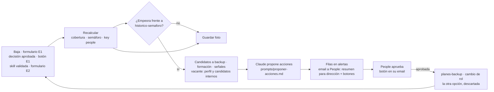

# Arquitectura

## Principio

**Separar QUÉ se hace (definiciones y reglas) de QUIÉN lo ejecuta (orquestador)** (D-01). Cambiar un umbral o la criticidad de una función es editar un archivo, no rehacer un flujo.

## Capas

| Capa | Qué contiene | Dónde | Quién la cambia |
|---|---|---|---|
| Definiciones | Taxonomía, funciones y criticidad, reglas, catálogo, prompts | Repo: `definiciones/`, `prompts/` | People |
| Datos | Empleados, skills, bandas, planes de backup, encuesta agregada | Google Sheets (origen: `datos/`) | People y managers |
| Cálculo | Cobertura, semáforo, key people, candidatos, señales | `calculo/cobertura.js` (referencia) → nodo de código de n8n (D-04) | Nadie a mano: es **determinista** |
| Ejecución | Disparadores, recálculo, alertas, emails | n8n (D-04) | — |
| Inteligencia | Normalizar skills, proponer acciones, informe | API de Claude | — |
| Visualización | Mapa de calor, key people, vistas de uso | Hoja `cobertura` con formato condicional | — |

## Flujo principal

| Paso | Tipo | Lee | Escribe |
|---|---|---|---|
| 1 Disparo | Evento | `empleados`, `alertas` | — |
| 2 Recálculo | **Regla** | todas las hojas de datos + `definiciones/` | `cobertura`, `key-people` |
| 3 Comparación | **Regla** | `historico-semaforo` | foto nueva en `historico-semaforo` |
| 4 Contexto | **Regla** | `catalogo-formacion`, señales | — |
| 5 Propuesta | **IA** | salida de 2-4 | — |
| 6 Aviso | Orquestador (escenario 1) | — | `alertas` (pendiente, con `grupo` para opciones excluyentes), un email a People (resumen para dirección + bloque confidencial con botones) |
| 7 Decisión | **Humano** | email de People (enlace) | `alertas.decision` (aprobada / descartada) |
| 8 Ciclo | Orquestador (escenario 1) | `alertas` | `planes-backup`, `empleados` (si es movilidad) → recálculo |

Cómo está montado en n8n (escenario 1 · baja de Elena; escenario 2 · actualización de skill; escenario 3 · agentes autónomos): `flujos/n8n/LEEME.md`, D-16, D-18 y D-21.

Segundo disparador (escenario 3, D-21): el calendario. Cada lunes, el **seguimiento de planes** avisa, recuerda y escala; el día 1 de cada mes, el **centinela** recalcula, detecta degradaciones y envía el informe para dirección (`prompts/informe-direccion.md`). Reglas: `definiciones/reglas-agentes.md`.

## Dónde está la IA y dónde no

- **Sí:** convertir texto en datos (captura) y datos en texto (propuestas, informe).
- **No:** el riesgo. Semáforo, prioridad y key people salen de reglas que se pueden leer en `definiciones/reglas-semaforo.md` y comprobar con `npm run verificar`. Si el CEO pregunta "¿por qué está en rojo?", la respuesta es una regla, no una opinión del modelo.

## Quién ve qué

| Rol | Ve |
|---|---|
| Empleado | Su perfil de skills |
| Manager | Su equipo y el semáforo de sus funciones. **Nunca** señales de rotación |
| Dirección | Mapa completo, key people, propuestas (sin señales individuales) |
| People | Todo, incluida la hoja `senales-rotacion-PEOPLE` |

En la demo, el control de acceso se representa con una hoja protegida. En producción: archivos separados y permisos por rol (fuera de alcance, §12).
